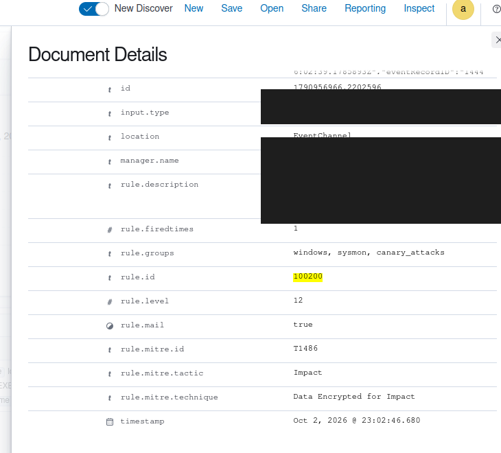
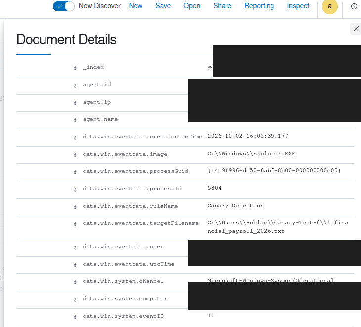
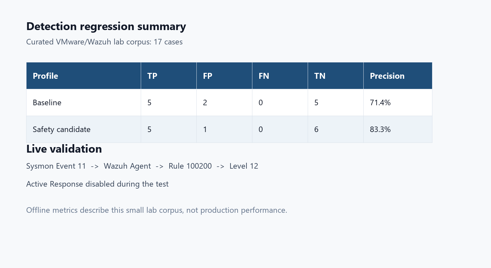

# Wazuh Detection Quality and Regression Lab

I use 17 sanitized telemetry cases to check five Wazuh rule conditions, compare false positives and catch changes in detection or triage decisions.

This repository is the validation companion to my [Active Directory Detection and Response Lab](https://github.com/LeeHoang26/ad-threat-detection-and-response-lab). The first project focuses on detection and response. This one focuses on testing, false positives, missing context and regression after a rule change.

## What I tested

The corpus contains 17 sanitized cases:

- 5 positive cases that should alert.
- 7 negative cases that should stay quiet.
- 5 edge cases where an analyst needs more context.

The detection set covers:

| Rule | Use case | Data source |
| --- | --- | --- |
| `100100` | Kerberoasting signal | Windows Security Event 4769 |
| `100101` | AS-REP Roasting signal | Windows Security Event 4768 |
| `100102` | Directory replication access | Windows Security Event 4662 |
| `100200` | Protected canary TXT file | Sysmon Event 11 |
| `100300` | WMI or WinRM remote shell | Sysmon Event 1 |

The cases include a legitimate DC replication pattern, incomplete event fields and a Recent-items shortcut that the broad canary baseline matched incorrectly.

## Lab result

The offline matcher produced these results on 12 scored positive/negative cases. The five edge cases are reported separately.

| Profile | TP | FP | FN | TN | Precision | Recall |
| --- | ---: | ---: | ---: | ---: | ---: | ---: |
| Baseline | 5 | 2 | 0 | 5 | 71.4% | 100% |
| Safety candidate | 5 | 1 | 0 | 6 | 83.3% | 100% |

These numbers describe this small, curated corpus. They are not production SOC metrics.

The repository also contains a live canary validation. A Sysmon Event 11 for `Canary-Test-6\!_financial_payroll_2026.txt` reached Wazuh and matched rule `100200` at level 12. The Active Response block was disabled during the test. The writer was Explorer because the test used a file copy operation, so the alert proves detection coverage and does not prove ransomware.

## Evidence

The Wazuh screenshots show the recorded live canary result with personal environment details covered. The regression summary records an offline run.







The raw `.evtx` files and the unedited screenshots stay outside this repository in a private evidence folder.

## Run it locally

The Python tools use only the standard library. Run them from the repository root:

```powershell
python scripts\generate_fixtures.py
python scripts\validate_fixtures.py
python scripts\run_regression.py --profile baseline
python scripts\run_regression.py --profile safety
python -m unittest discover -s tests
```

Fixture validation prints `FIXTURE VALIDATION PASSED: 17 cases`; unittest reports its test count and result.

The generated reports are in `reports/`. Each profile has explicit expected rule, outcome and action contracts. A changed outcome or action fails the runner; known baseline false positives remain visible in the metrics. Unit tests cover missing context, lookalike executable names and regression failures without adding cases to the 17-case corpus.

The `Decision` column is an offline analyst recommendation. `manual_review` retains the alert and does not label a real event benign.

## VMware validation

The recorded live lab used these machines:

| Machine | Role |
| --- | --- |
| `SIEM-SRV` | Ubuntu, Wazuh Manager and Dashboard |
| `DC01` | Windows Server, Active Directory and Security events |
| `WK01` | Windows endpoint, Sysmon and Wazuh Agent |

The manual VMware walkthrough is kept outside this repository. For live validation:

1. Check the Windows Event Viewer or Sysmon event.
2. Check the corresponding alert in Wazuh Discover.
3. Compare the live fields with the expected fixture.
4. Record actual results only when the exact event has passed through the Windows Agent.

Pasted JSON in Ruleset Test is useful for inspecting decoder fields. It is not a substitute for Windows EventChannel validation.

## Case studies

- [Canary shortcut scope test](docs/canary-shortcut-case-study.md) explains why a `.txt.lnk` shortcut created a noisy baseline signal and how the candidate keeps the protected `.txt` detection.
- [Methodology](docs/methodology.md) explains the corpus and metrics.
- [Tuning notes](docs/tuning-notes.md) records the investigation decisions.
- [Limitations](docs/limitations.md) records what this lab does not prove.

## Safety scope

This repository contains sanitized telemetry and detection tests. It does not disable accounts, block hosts, terminate processes or send messages. The canary Active Response handler was kept disabled while the candidate rule was validated.

Only sanitized fixtures and screenshots are included; raw EVTX and unedited screenshots remain outside the repository.
